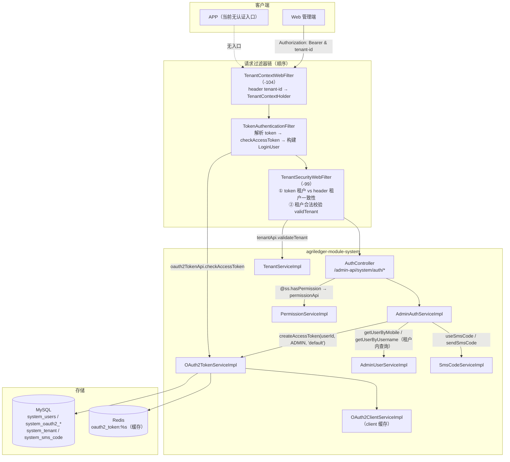
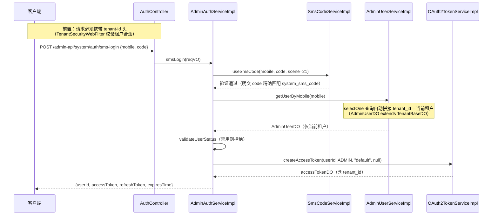

# 阶段 1 · 源码分析报告（现有认证 / 多租户 / RBAC 体系）

> 改造任务：《农e链全局账号与多租户认证改造执行方案》阶段 1。
> 本报告为只读勘察结论，未修改任何业务代码。
> 勘察日期：2026-11-05。所有结论以当前仓库代码为准，均标注 `文件:行号`。

## 路径约定

为控制篇幅，正文使用以下缩写（均相对仓库根 `E:\agriledger`）：

| 缩写 | 实际路径 |
|---|---|
| `<system>` | `agriledger-module-system/src/main/java/com/agsccc/agriledger/module/system` |
| `<infra>` | `agriledger-module-infra/src/main/java/com/agsccc/agriledger/module/infra` |
| `<common>` | `agriledger-framework/agriledger-common/src/main/java/com/agsccc/agriledger/framework/common` |
| `<security>` | `agriledger-framework/agriledger-spring-boot-starter-security/src/main/java/com/agsccc/agriledger/framework/security` |
| `<biz-tenant>` | `agriledger-framework/agriledger-spring-boot-starter-biz-tenant/src/main/java/com/agsccc/agriledger/framework/tenant` |
| `<web>` | `agriledger-framework/agriledger-spring-boot-starter-web/src/main/java/com/agsccc/agriledger/framework/web` |
| `ruoyi-vue-pro.sql` | `sql/mysql/ruoyi-vue-pro.sql` |

## 0. 执行摘要

1. 当前仓库是 Yudao（ruoyi-vue-pro）单体精简版：仅 `system` + `infra` 两个业务模块，多租户开启（`agriledger.tenant.enable=true`）。
2. **商户域零存在**：`merchant_org` / `merchant_org_apply` / `merchant_user` 在 Java、SQL、文档中全部零命中（已经用户确认，按"全新设计"前提处理，见 `03_最终DDL建议.md`）。
3. 认证仅有管理端入口 `/admin-api/system/auth/*`；短信验证码登录（`smsLogin`）已存在，但按"手机号 + 请求头租户"查询租户表 `system_users`，**不存在全局账号概念**。
4. Token 为不透明随机 UUID（非 JWT），MySQL 主存 + Redis 缓存，`tenant_id` 记录在 token 行上；**Refresh Token 不轮换**；有效期由 `system_oauth2_client` 表按 `clientId` 动态配置——这是实现"Web/APP 双端独立会话 + 独立有效期"的天然扩展点。
5. `/app-api` 前缀会推导出 `userType=MEMBER`，与 ADMIN 类型 token 冲突即被拒绝；APP 端目前无任何认证入口，**AppAuthController 不存在**。
6. 租户安全边界完整：header 租户与 token 租户不一致直接 403；但已存在面向"平台管理员跨租户支持"的 `visit-tenant-id` 通道，且该通道会**跳过功能与数据权限校验**，与"商户账号切换自己租户"的语义必须严格区隔。
7. 存在运行时隐患：`member` 模块删除后残留的 `MemberService` 反射存根，在 MEMBER 类型用户登出/发送短信邮件时会抛运行时异常。

## 1. 现有认证架构图

### 1.1 组件关系图

### 1.2 短信验证码登录时序（现状）

## 2. 关键链路详解

### 2.1 认证入口（唯一：管理端 AuthController）

`<system>/controller/admin/auth/AuthController.java`，`@RequestMapping("/system/auth")`（L46），包路径 `controller.admin.**` 自动映射 `/admin-api` 前缀（`<web>/config/WebProperties.java`）。

| 方法 | URL | 行号 | 说明 |
|---|---|---|---|
| login | POST `/login` | L67-72 | 账号密码，@PermitAll |
| logout | POST `/logout` | L74-83 | @PermitAll |
| refreshToken | POST `/refresh-token` | L85-91 | @PermitAll |
| getPermissionInfo | GET `/get-permission-info` | L93-118 | 需登录，组装用户+角色+菜单 |
| register | POST `/register` | L120-125 | @PermitAll |
| **smsLogin** | POST `/sms-login` | L129-135 | @PermitAll + @RateLimiter（60s/6 次，key=mobile） |
| sendLoginSmsCode | POST `/send-sms-code` | L137-143 | @PermitAll |
| resetPassword | POST `/reset-password` | L145-151 | @PermitAll |
| socialLogin | POST `/social-login` | L168-173 | @PermitAll |

**APP 端：`AppAuthController` 不存在**。`controller/app` 下现存 4 个 Controller，3 个 @PermitAll（AppDictDataController / AppAreaController / AppTenantController），仅 `<infra>/controller/app/file/AppFileController.java` 需登录——但 `/app-api` 前缀推导 userType=MEMBER，与 ADMIN token 冲突被拒（见 2.4），即**当前 ADMIN token 实际无法访问任何 `/app-api` 受保护接口**。`<system>/controller/app/user/` 为空目录。

### 2.2 登录服务（AdminAuthServiceImpl）

`<system>/service/auth/AdminAuthServiceImpl.java`：

- **密码登录** `login`（L98-112）：validateCaptcha（开关 `agriledger.captcha.enable`，L186-205）→ `authenticate`（L79-94：getUserByUsername + BCrypt 比对，失败抛 `AUTH_LOGIN_BAD_CREDENTIALS` 并写登录日志）→ `createTokenAfterLoginSuccess`（L207-217）。
- **短信登录** `smsLogin`（L133-145）：`smsCodeApi.useSmsCode(scene=21)` → `userService.getUserByMobile`（**租户内查询**，查无抛 USER_NOT_EXISTS）→ `createTokenAfterLoginSuccess(LOGIN_MOBILE)`。
- **sendSmsCode**（L115-130）：scene=23 先校验图形验证码；**`getUserByMobile` 为空抛 `AUTH_MOBILE_NOT_EXISTS`**（L125-127）——即当前发送登录短信验证码也以"该手机号在本租户已存在用户"为前提，全局账号模式下该前提要反转。
- **createTokenAfterLoginSuccess**（L207-217）：validateUserStatus → createLoginLog → `oauth2TokenService.createAccessToken(user.getId(), getUserType().getValue(), "default", null)`。
- **getUserType() 固定返回 `UserTypeEnum.ADMIN`**（L268-270），所有登录签发的 token userType 恒为 2。
- **refreshToken**（L227-230）→ `oauth2TokenService.refreshAccessToken(refreshToken, "default")`。
- **logout**（L233-241）→ `removeAccessToken(token)`；`createLogoutLog`（L243-258）中 userType≠ADMIN 分支调用 `memberService.getMemberUserMobile(userId)`（L252）——**member 模块已删，运行时会抛异常**（见第 7 节隐患）。
- **登录链路本身不校验租户**（无 TenantApi 依赖）；租户合法性在每次请求时由 TenantSecurityWebFilter 校验。

### 2.3 OAuth2 Token 体系

数据对象（`<system>/dal/dataobject/oauth2/`）：

| DO | 表 | 关键字段 | 租户 |
|---|---|---|---|
| OAuth2AccessTokenDO | `system_oauth2_access_token`（DDL L23073） | accessToken、refreshToken、userId、userType、userInfo(Map)、clientId、scopes、expiresTime | TenantBaseDO（含 tenant_id） |
| OAuth2RefreshTokenDO | `system_oauth2_refresh_token`（DDL L23239） | refreshToken、userId、userType、clientId、scopes、expiresTime（**无 userInfo**） | TenantBaseDO |
| OAuth2ClientDO（@TenantIgnore L26） | `system_oauth2_client`（DDL L23134） | **accessTokenValiditySeconds / refreshTokenValiditySeconds** | 全局表 |

`<system>/service/oauth2/OAuth2TokenServiceImpl.java`：

- `createAccessToken`（L59-67）：校验 client → 建 refresh token（UUID，有效期=now+`clientDO.refreshTokenValiditySeconds`，L197-204）→ 建 access token（UUID，有效期=now+`clientDO.accessTokenValiditySeconds`，L177-195；**tenantId 优先取 refreshTokenDO.tenantId，为 null 再取 TenantContextHolder**，L184-190）→ MySQL insert + Redis 缓存。
- **`refreshAccessToken`（L69-99）：不轮换 refresh token**——查到 refreshTokenDO 后仅删除其关联的全部旧 access token（L85-89），再复用同一 refreshTokenDO 签发新 access token。过期才删除并抛 UNAUTHORIZED（L92-95）。
- `getAccessToken`（L101-126）：Redis 优先 → MySQL → **兜底把 refreshToken 当 accessToken 用**（L112-119，积木报表/WebSocket 场景）。
- `checkAccessToken`（L128-138）：不存在/过期抛 UNAUTHORIZED。
- `removeAccessToken(String)`（L140-154）：删 access + 对应 refresh（MySQL + Redis）。
- `removeAccessToken(userId, userType)`（L156-170）：按用户踢下线。
- `buildUserInfo`（L221-236）：ADMIN → nickname + deptId；MEMBER → 空 Map。

有效期动态配置证据：`<system>/service/oauth2/OAuth2ClientServiceImpl.java` `getOAuth2ClientFromCache` @Cacheable（L109-113），`updateOAuth2Client`/`deleteOAuth2Client` @CacheEvict（L52-73）→ 改库即生效。种子数据（ruoyi-vue-pro.sql L23165-23202）：`default`（access 1800s / refresh 2592000s=30 天）、`test`（1800s/43200s）。

Redis key：`<system>/dal/redis/RedisKeyConstants.java` `OAUTH2_TOKEN = "oauth2_token:%s"`（L68）；DAO：`<system>/dal/redis/oauth2/OAuth2AccessTokenRedisDAO.java`（TTL=剩余有效期）。

**结论**：Token 是不透明 UUID，全部状态在 DB/Redis，服务端可控可撤销；双端会话隔离可用"独立 clientId + 独立签发/刷新/登出入口"实现，无需更换 Token 体系。

### 2.4 请求过滤器链与 userType 推导

**TokenAuthenticationFilter**（`<security>/core/filter/TokenAuthenticationFilter.java`）：

- doFilterInternal（L40-69）：`obtainAuthorization`（Header `Authorization` 优先 / Parameter `token` 兜底，剥 `Bearer `）→ `WebFrameworkUtils.getLoginUserType(request)` → `buildLoginUserByToken`（L71-93）。
- **userType 一致性检查（L78-83）：按 URL 前缀推导的期望 userType 与 token 中 userType 不一致 → 抛 `AccessDeniedException("错误的用户类型")`**。前缀推导在 `<web>/core/util/WebFrameworkUtils.java` L101-118：`/admin-api` → ADMIN(2)、`/app-api` → MEMBER(1)。
- mock 模式（L105-117）：`mock-enable=true` 且 token 以 mockSecret（默认 `test`）开头时按数字构造 LoginUser。dev/test 开启，**prod 显式关闭**（`application-prod.yaml` L118）。
- LoginUser（`<security>/core/LoginUser.java`）：id、userType、info(Map)、tenantId、scopes、expiresTime、visitTenantId；**无 userKey/session 维度**。

**TenantContextWebFilter**（`<biz-tenant>/core/web/TenantContextWebFilter.java`，order=-104）：header `tenant-id` → `TenantContextHolder.setTenantId`（TransmittableThreadLocal），finally clear。

**TenantSecurityWebFilter**（`<biz-tenant>/core/security/TenantSecurityWebFilter.java`，order=-99，只拦 `/admin-api`、`/app-api`）：

- 登录用户（L66-83）：header 无租户 → 用 `LoginUser.tenantId` 回填；**header 租户 ≠ 登录用户租户 → error 日志 + 403"您无权访问该租户的数据"**（L75-82）。
- 非忽略 URL（L86-101）：无租户 → 400；`validTenant`（不存在/停用/过期，`<system>/service/tenant/TenantServiceImpl.java` L81-92）。
- 忽略 URL 且无租户 → `setIgnore(true)`（L102-106）。
- **登录接口也必须携带 tenant-id 头**（未登录且非忽略 URL 时，L88-93）。

**跨租户访问通道（现状已有，需区隔）**：`<biz-tenant>/core/web/TenantVisitContextInterceptor.java`——header `visit-tenant-id` + 权限 `system:tenant:visit`（菜单 id=920，ruoyi-vue-pro.sql L14017）→ `loginUser.setVisitTenantId(...)` + 切换 TenantContextHolder，afterCompletion 恢复；配套 `SecurityFrameworkUtils.skipPermissionCheck()`（L152-162）：跨租户期间 **hasPermission/hasRole/hasScope 全部直接放行**（`<security>/core/service/SecurityFrameworkServiceImpl.java` L31/51/71）。该通道面向平台运营人员跨租户支持，**与本次"商户账号切换自己名下租户"语义不同**，改造时必须两条通道分离，避免商户借 visit 通道获得无权限校验的跨租户访问。

### 2.5 短信验证码

位于 system 模块（非 infra）：`<system>/api/sms/SmsCodeApi.java` + `<system>/service/sms/SmsCodeServiceImpl.java`：

- `createSmsCode`（L55-79）：60s 发送频率限制、当日上限 10 条、6 位随机码（000000-999999）、**明文 code 存 `system_sms_code`**（按 mobile+code+scene 精确查询校验，L95-112）。
- `useSmsCode`（L82-88）：校验过期/已使用，使用后置 used/usedTime/usedIp。
- 场景枚举 `<system>/enums/sms/SmsSceneEnum.java`：MEMBER_LOGIN=1、MEMBER_UPDATE_MOBILE=2、MEMBER_UPDATE_PASSWORD=3、MEMBER_RESET_PASSWORD=4、**ADMIN_MEMBER_LOGIN=21**、ADMIN_MEMBER_REGISTER=22、ADMIN_MEMBER_RESET_PASSWORD=23。
- 配置 `agriledger.sms-code`（application.yaml L192-197）：expire-times 10m / send-frequency 1m / send-max 10。

### 2.6 RBAC 与数据权限（全部可复用）

- **功能权限**：`@PreAuthorize("@ss.hasPermission('...')")` → `<security>/core/service/SecurityFrameworkServiceImpl.java`（先 skipPermissionCheck，再 `permissionApi.hasAnyPermissions`）→ `<system>/service/permission/PermissionServiceImpl.java` `hasAnyPermissions`（L62-83，角色-菜单-权限三段缓存 + super_admin 兜底）。**该链路只认 userId + 权限标识，不区分 userType**——APP 端只要 token 的 userId 是 system_users.id，RBAC 天然可用。
- **数据权限**：`<fw>/agriledger-spring-boot-starter-biz-data-permission` 的 `DeptDataPermissionRule`（dept_id/user_id 列约定，L58-59；**仅处理 ADMIN 用户类型**，L90-145）。当前配置表：`system_users`（dept 列 dept_id / user 列 id）与 `system_dept`（`<system>/framework/datapermission/config/DataPermissionConfiguration.java` L17-26）。**若 APP token 采用 MEMBER userType，数据权限将失效**——这是 APP 端 userType 选型的关键约束（见第 5.1 节）。
- 关联表：system_role / system_menu / system_role_menu / system_user_role（无 system_role_dept，自定义部门存 `system_role.data_scope_dept_ids` JSON 列）。

### 2.7 租户上下文机制

- 拦截器 `<biz-tenant>/core/db/TenantDatabaseInterceptor.java`：TenantLineInnerInterceptor 置于 MP 插件第 0 位；`computeIgnoreTable`（L68-81）规则：非 MP 实体→忽略；**TenantBaseDO 子类→拦截**；DO 有 @TenantIgnore→忽略；**其余默认拦截**。
- 全局表（@TenantIgnore DO，22 张）：system_tenant、system_tenant_package、system_menu、system_oauth2_client、dict/mail/notify/sms 系列及 infra 8 张。
- 租户表（TenantBaseDO）：system_users、system_dept、system_role、system_role_menu、system_oauth2_access_token/refresh_token、social_client。
- `TenantUtils.execute/executeIgnore`（`<biz-tenant>/core/util/TenantUtils.java`）与 `@TenantIgnore` AOP 是切租户执行的手段（租户创建、token userInfo 加载、清理任务等）。
- 租户创建参考实现：`<system>/service/tenant/TenantServiceImpl.java` `createTenant`（L97-118）——校验名称/域名/套餐 → 插入租户 → `TenantUtils.execute(新租户)`：建 `tenant_admin` 角色（L128-137，绑定套餐菜单）→ `userService.createUser` + `assignUserRole`（L120-126）→ 回写 contactUserId。**不创建部门/岗位**。这是商户开通服务的直接复用样板。

## 3. 现状 vs 目标差异矩阵

| # | 目标要求（方案章节） | 现状 | 差距 |
|---|---|---|---|
| 1 | §3.1 手机号验证码登录统一走全局账号（跨租户身份） | smsLogin 按"手机号+当前租户"查 system_users；发码前还要求该手机号在本租户已有用户 | 需新增 system_account 并重构登录前置（先全局账号，后选租户） |
| 2 | §2 全局账号表 + 账号-租户用户关联表 | 均不存在 | 全新建（见 03 报告） |
| 3 | §3.2 Web 端复用 Yudao 原生登录 + 动态有效期 | 已具备（clientId=default + oauth2_client 表动态配置） | 登录入口需叠加"全局账号校验 + 租户用户映射"；Token 机制不动 |
| 4 | §3.3 APP 独立登录、2h/30d、双端互不影响（轮换/重放/绝对期限已裁剪） | APP 无认证入口 | 新建 AppAuthController；app 独立 client（03 报告 §6.1）；刷新保持原生行为 |
| 5 | §3.4 Token 上下文含 accountId/systemUserId/tenantId/clientType/sessionId | LoginUser 无 accountId/clientType/sessionId；userType 仅 ADMIN/MEMBER | LoginUser 与 token userInfo 需扩展承载全局账号维度 |
| 6 | §4 租户切换（服务端校验关联 + 重签上下文） | header 租户≠token 租户直接 403；visit-tenant-id 通道跳过权限校验 | 新建面向商户的切换接口：校验 account-tenant 关联后重签 token；visit 通道保留给平台运营并收紧 |
| 7 | §6 RBAC/数据权限租户内独立 | 已具备（system_users/role/menu/数据权限全为租户表） | 复用即可；仅需保证切换后按新租户用户加载 |
| 8 | §5 商户入驻（个人免审/企业审核/驳回重提） | merchant 域零存在 | 全新模块（建议 agriledger-module-merchant） |
| 9 | §7 数据迁移 | merchant_user 不存在 → 无旧账号映射；存量仅 system_users 手机号回填 | 迁移规模收缩为账号回填 + rel 建立（见 02 报告） |
| 10 | member_user 不再引用 | 实体/表已删，但 MemberService 反射存根 + MEMBER 场景枚举残留 | 需清理（第 7 节） |

## 4. 需要修改 / 新增的类、方法和接口

> 以下为阶段 3-5 的改动清单（本次不实施）。跨模块调用一律走被调方 `api` 包（项目规范）。

### 4.1 framework 层（扩展点，尽量少改）

| 位置 | 改动 | 动因 |
|---|---|---|
| `<security>/core/filter/TokenAuthenticationFilter.java` L78-83 | userType 一致性检查放宽策略：为 `/app-api` 放行携带 ADMIN 类型 token 的管理端 APP 请求（按 clientId 或配置开关识别），或按 5.1 节选型调整推导 | APP 复用 system_user RBAC 的前置条件 |
| `<security>/core/LoginUser.java` | 增加 accountId、clientId（或经 userInfo Map 携带，权衡见 5.1） | Token 上下文要求 §3.4 |
| ~~`OAuth2TokenServiceImpl.refreshAccessToken` 轮换扩展 + `OAuth2RefreshTokenDO` 加列~~ | **2026-11-06 用户决定暂缓**：保持原生刷新行为，不实现轮换/重放检测/绝对期限（R0 泄露风险暂缓，记录于 03 报告 §6.2） | 需求裁剪 |
| `<biz-tenant>/core/web/TenantVisitContextInterceptor.java`（不改代码，改边界） | 明确 visit 通道仅限平台运营（`system:tenant:visit` 权限不授予商户角色）；商户切换走新接口而非 visit 头 | §4.3 安全约束 |

### 4.2 system 模块（全局账号 + 认证改造）

新增：

- `dal/dataobject/account/SystemAccountDO`、`SystemAccountUserRelDO` + Mapper（@TenantIgnore 全局表）
- `service/account/SystemAccountService(Impl)`：getOrCreateAccountByMobile（唯一键冲突捕获 + 重查，§8.1）、账号状态校验、关联关系查询/校验（getValidRel、listTenantsByAccount）
- `api/account/SystemAccountApi(Impl)`：供 merchant 模块跨模块调用（创建关联、校验归属）
- `controller/admin/auth/` 扩展：登录响应增加 accountId/租户列表；新增"可访问租户列表 / 切换租户"接口（切换：校验 rel 有效 + 租户状态 + system_user 归属与状态 → 重签当前 client 的 token）
- `controller/app/auth/AppAuthController`：APP 登录 / 刷新 / 登出（独立入口，复用全局账号校验）
- SmsSceneEnum 增加全局账号登录场景（或复用 21，语义调整需评审）

修改：

- `<system>/service/auth/AdminAuthServiceImpl.java`：smsLogin 重构为"验证码 → system_account → 选择/校验租户 → 租户内 system_user → createToken（userInfo 携带 accountId）"；sendSmsCode 去除"本租户已存在用户"前提；createLogoutLog 移除 memberService 分支（L249-253）
- `<system>/service/auth/AuthConvert.java`、相关 VO：登录响应结构扩展
- `ErrorCodeConstants.java`：新增全局账号/关联/商户错误码段（分段编号，避开既有 1-002-000-000~1-002-028-000）

### 4.3 新 merchant 模块（建议 `agriledger-module-merchant`，全新建）

遵循仓库模块化单体模式（参考 system 模块布局；根 pom + server pom 增加模块）：

- `dal/dataobject/org/MerchantOrgDO`、`dal/dataobject/org/MerchantOrgApplyDO` + Mapper
- `service/org/MerchantOrgService(Impl)`：个人商户免审开通（事务：创建租户[复用 TenantService.createTenant 模式] → merchant_org → 租户 system_user → rel → 管理员角色；幂等靠唯一键）
- `service/org/MerchantOrgApplyService(Impl)`：企业申请提交（uk_credit_code 并发兜底）、审核通过（条件更新防并发 + 事务开通）、审核驳回、驳回重提（UPDATE 原记录，状态机校验）
- `controller/admin/merchant/`：管理端申请审核接口（平台权限 `merchant:org-apply:*`）；`controller/app/...` 或 admin 下商户端接口按 URL 规范落位
- 跨模块依赖：经 `SystemAccountApi`、`TenantApi`、`AdminUserApi`（如需）调用 system 模块，禁止直连其 Service/Mapper

## 5. 关键设计决策建议（待确认）

### 5.1 APP 端会话方案（推荐：独立 clientId + 保留 ADMIN userType）

| 方案 | 说明 | 获得 | 牺牲 |
|---|---|---|---|
| **A（推荐）** | APP 走独立 clientId（如 `app`，2h/30d 由 oauth2_client 配置）+ 独立登录/刷新/登出入口；token userType 仍为 ADMIN；修改 TokenAuthenticationFilter 允许"ADMIN token 访问 /app-api"（按 client 识别） | RBAC、数据权限（DeptDataPermissionRule 仅认 ADMIN）、权限链路零改动；双端有效期独立配置；登出互不影响（removeAccessToken 按 token） | 需改 framework 一处 userType 检查逻辑（属自有 starter，非 Yudao 核心不可改域，需在 ADR 记录） |
| B | APP token 用 MEMBER userType，userId=system_users.id | 不改 TokenAuthenticationFilter | DeptDataPermissionRule 需扩展支持 MEMBER；buildUserInfo MEMBER 分支需实现；与"MEMBER=会员"的既有语义冲突，语义污染大 |

方案 A 的会话隔离原理：Web 与 APP 的 token 属不同 client，各自独立签发/刷新/登出；`removeAccessToken(token)` 只删自身（L140-154），天然互不影响。Refresh 轮换仅在 APP client 上开启（按 client 开关，Web 保持现状不破坏兼容，§3.2）。

### 5.2 Refresh Token 轮换与重放检测（已裁剪，2026-11-06 用户决定暂缓）

原建议：刷新时轮换 refresh token（family_id 串联会话族）、被轮换旧 token 再现即判定重放并撤销全族、`family_start_time` 支撑 90 天绝对会话期限。**用户决定暂不实现**：`refreshAccessToken` 保持原生行为（`OAuth2TokenServiceImpl.java:69-99`，复用同一 refresh token），不新增 family_id/rotated/family_start_time 三列。

- 影响：方案 §3.3"旧 Refresh Token 不得重复使用/重放受控/绝对期限"三项验收本次不满足；
- 遗留风险（已接受）：APP refresh token 30 天有效期内泄露后可被持续使用且无法检测重放；
- 后续启用路径：refresh token 表加列迁移脚本 + 仅对 app client 启用轮换的代码改造，与本批交付无耦合。

### 5.3 租户切换的实现路径（推荐：显式切换接口 + 重签 token）

不采用前端改 header（会被 403），不复用 visit 通道（跳过权限校验，语义不符）。新建 `POST /admin-api/system/auth/switch-tenant`（及 APP 对应入口）：服务端按 §4.2 流程校验后吊销当前 client 的旧 token 并重签目标租户上下文 token——旧租户 token 立即失效，满足"切换后不能继续使用旧租户上下文"（§4.3）。

## 6. 配置现状摘要

`agriledger-server/src/main/resources/application*.yaml`：

- `agriledger.tenant.enable=true`；ignore-urls 仅 `/jmreport/*`；ignore-visit-urls 含 `/admin-api/system/auth/**`；ignore-tables 为空；ignore-caches 7 项（application.yaml L176-191）。
- `agriledger.security.permit-all-urls` 仅 `/admin-api/mp/open/**`（L143-145）；mock-enable：dev/test=true、**prod=false**。
- captcha：dev/test=false、prod=true；`agriledger.sms-code` 见 2.5。
- 端口：dev=18080，test/prod=48080。无独立 oauth2 配置项（全部由 oauth2_client 表驱动）。

## 7. 已知隐患与清理项（随改造一并处理）

| # | 隐患 | 位置 | 影响 |
|---|---|---|---|
| 1 | MemberService 反射加载已删除的 `module.member.api.user.MemberUserApi` | `<system>/service/member/MemberServiceImpl.java`（反射 loadClass） | 调用点：AdminAuthServiceImpl L252（MEMBER 登出）、MailSendServiceImpl L122、SmsSendServiceImpl L73 → 运行时抛异常 |
| 2 | MEMBER 场景枚举残留（scene 1-4）无消费方 | `<system>/enums/sms/SmsSceneEnum.java` L18-21 | 语义混乱，建议清理或重定义 |
| 3 | 会员管理菜单种子数据残留（菜单 404 及子项） | ruoyi-vue-pro.sql L11492-11502 | 界面出现无效菜单（部署数据问题，非代码） |
| 4 | `getAccessToken` 兜底把 refreshToken 当 accessToken 用（L112-119） | OAuth2TokenServiceImpl | 保持现状；若未来启用轮换（已裁剪，2026-11-06）需复核该兜底路径 |
| 5 | pom 中 member 模块注释残留 | 根 pom L18、server pom L38 | 无运行影响，保持注释即可 |

## 8. 关键源码文件清单

认证：
1. `<system>/controller/admin/auth/AuthController.java`（及 vo/ 全部）
2. `<system>/service/auth/AdminAuthService.java` / `AdminAuthServiceImpl.java`
3. `<system>/service/member/MemberService.java` / `MemberServiceImpl.java`（隐患）
4. `<system>/convert/auth/AuthConvert.java`

OAuth2：
5. `<system>/dal/dataobject/oauth2/{OAuth2AccessTokenDO,OAuth2RefreshTokenDO,OAuth2ClientDO,OAuth2CodeDO}.java`
6. `<system>/service/oauth2/{OAuth2TokenService,OAuth2TokenServiceImpl,OAuth2ClientService,OAuth2ClientServiceImpl,OAuth2GrantServiceImpl}.java`
7. `<system>/dal/redis/RedisKeyConstants.java`、`<system>/dal/redis/oauth2/OAuth2AccessTokenRedisDAO.java`
8. `<system>/controller/admin/oauth2/{OAuth2OpenController,OAuth2TokenController,OAuth2ClientController}.java`、`<system>/enums/oauth2/OAuth2ClientConstants.java`

短信：
9. `<system>/api/sms/SmsCodeApi(Impl).java`、`<system>/service/sms/{SmsCodeServiceImpl,SmsSendServiceImpl}.java`
10. `<system>/dal/dataobject/sms/SmsCodeDO.java`、`<system>/enums/sms/SmsSceneEnum.java`、`<system>/framework/sms/config/SmsCodeProperties.java`

框架层：
11. `<security>/core/filter/TokenAuthenticationFilter.java`
12. `<security>/core/{LoginUser.java,util/SecurityFrameworkUtils.java,service/SecurityFrameworkServiceImpl.java}`
13. `<security>/config/{SecurityProperties,AgriledgerSecurityAutoConfiguration,AgriledgerWebSecurityConfigurerAdapter}.java`
14. `<web>/core/util/WebFrameworkUtils.java`、`<web>/config/WebProperties.java`
15. `<biz-tenant>/core/web/{TenantContextWebFilter,TenantVisitContextInterceptor}.java`
16. `<biz-tenant>/core/security/TenantSecurityWebFilter.java`、`<biz-tenant>/core/service/TenantFrameworkServiceImpl.java`
17. `<biz-tenant>/core/db/{TenantDatabaseInterceptor,TenantBaseDO}.java`、`<biz-tenant>/core/context/TenantContextHolder.java`、`<biz-tenant>/core/util/TenantUtils.java`
18. `<common>/enums/UserTypeEnum.java`、`<common>/biz/system/oauth2/OAuth2TokenCommonApi.java` 及 dto

用户/租户/权限：
19. `<system>/service/user/AdminUserServiceImpl.java`（getUserByMobile L333、validateMobileUnique L512-527、createUser L104-129）
20. `<system>/dal/mysql/user/AdminUserMapper.java`（selectByMobile L24）
21. `<system>/service/tenant/{TenantServiceImpl,TenantPackageServiceImpl}.java`、`<system>/api/tenant/TenantApiImpl.java`
22. `<system>/service/permission/PermissionServiceImpl.java`、`<system>/api/permission/PermissionApiImpl.java`
23. `<system>/framework/datapermission/config/DataPermissionConfiguration.java`
24. `<system>/enums/ErrorCodeConstants.java`

配置/数据/文档：
25. `agriledger-server/src/main/resources/application{,-dev,-test,-prod}.yaml`
26. `sql/mysql/ruoyi-vue-pro.sql`（关键表行号见 02 报告）
27. `docs/agri_saas_zcode_implementation_plan.md`（旧实施计划，与本方案的差异见交付说明）

## 9. 证据缺口（明确未找到项）

- AppAuthController：不存在。
- LoginUser.userKey / session 维度：不存在（新版 yudao 特性未引入）。
- 登录链路中的 TenantApi.validateTenant 调用：不存在（租户校验在过滤器层）。
- merchant_user / MerchantUser / merchant_org / merchant_org_apply / apply_user_id：全仓零命中。
- member_user 表/实体：不存在（仅菜单种子与反射存根残留）。
