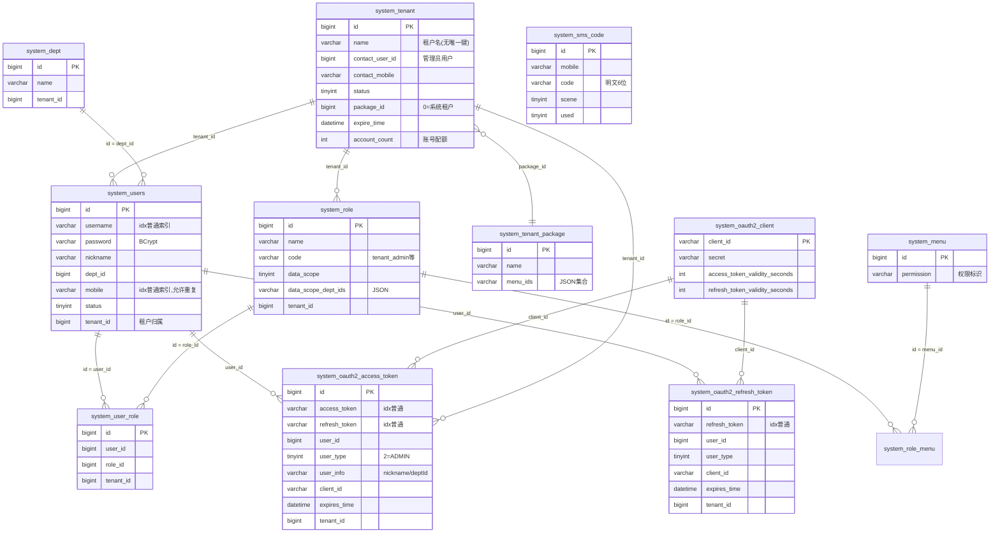

# 阶段 1 · 数据库分析报告（现有库表 / 存量数据 / 迁移方案与风险）

> 改造任务：《农e链全局账号与多租户认证改造执行方案》阶段 1。
> 本报告为只读勘察结论，**未连接、未执行任何数据库操作**。DDL 原文摘录自 `sql/mysql/ruoyi-vue-pro.sql`（下称 `主SQL`）。
> 行号以当前仓库文件为准。勘察日期：2026-11-05。

## 0. 执行摘要

1. `sql/mysql/` 仅两个文件：`ruoyi-vue-pro.sql`（全量初始化，53 张业务表）与 `quartz.sql`（11 张 QRTZ_ 表）。**无增量迁移目录**（无 increment/update/flyway/liquibase）。
2. **merchant_user / merchant_org / merchant_org_apply / member_users / system_account / account_user_rel 均不存在**（全仓 Java/SQL/yaml/docs 零命中；已经用户确认按"全新设计"处理）。
3. **全库 DDL 零 `UNIQUE KEY`**：所有二级索引均为普通 `INDEX`，唯一性完全依赖应用层校验 + 逻辑删除 `deleted bit(1)`。任何"数据库级唯一保障"（全局手机号、信用代码等）都需要从零设计——且必须先解决**逻辑删除与唯一约束共存**问题（见 03 报告 §1）。
4. `system_users` 是租户表（含 `tenant_id`），`mobile`/`username`/`email` 唯一性仅为**租户内 Java 校验**（`AdminUserServiceImpl.java:512-527` 走 MP 租户过滤查询）。种子数据本身已含跨租户重复手机号。
5. 存量迁移规模收缩：无 merchant_user 历史账号映射，迁移仅剩 ①`system_users` 存量手机号回填 `system_account`；②按租户-用户对建立 `system_account_user_rel`；③oauth2 client 种子数据补充。冲突主要来自跨租户重复手机号与空手机号。

## 1. 数据库概况

| 项 | 现状 | 证据 |
|---|---|---|
| 数据库 | MySQL（dev 库名 `agri`，AGENTS.md） | — |
| 字符集/引擎 | utf8mb4 / InnoDB（建表模板统一） | 主SQL 各 CREATE TABLE |
| 逻辑删除 | `deleted bit(1) NOT NULL DEFAULT b'0'` + `@TableLogic`（BaseDO） | `<common>/.../mybatis/core/dataobject/BaseDO.java` |
| 审计列 | creator/create_time/updater/update_time 自动填充 | BaseDO |
| 租户列 | 租户表带 `tenant_id bigint NOT NULL DEFAULT 0`；全局表无 | 见 §3 |
| 唯一约束 | **0 个 UNIQUE KEY** | grep 全文件 |
| 主键 | `id bigint AUTO_INCREMENT` | 全部 |
| 迁移组织 | 仅全量初始化脚本，无增量机制 | `sql/` 目录树 |

> 假设与限制：仓库未标注 MySQL 具体版本，DDL 建议按 **MySQL 5.7/8.0 兼容**写法（不使用函数索引、CTE DDL 等 8.0 专有特性），见 03 报告。

## 2. 现有数据库 ER 图（与本次改造相关的核心表）



说明：图中均为**逻辑关联，无数据库外键**（项目风格不建外键）。目标模型新增的 `system_account` / `system_account_user_rel` / `merchant_org` / `merchant_org_apply` 见 03 报告。

## 3. 关键表 DDL 摘录与评估

### 3.1 system_users（主SQL L28677-28704）

```sql
CREATE TABLE `system_users` (
    `id`          bigint NOT NULL AUTO_INCREMENT COMMENT '用户ID',
    `username`    varchar(30) NOT NULL COMMENT '用户账号',
    `password`    varchar(100) NOT NULL DEFAULT '' COMMENT '密码',
    `nickname`    varchar(30) NOT NULL COMMENT '用户昵称',
    `remark`      varchar(500) NULL DEFAULT NULL COMMENT '备注',
    `dept_id`     bigint NULL DEFAULT NULL COMMENT '部门ID',
    `post_ids`    varchar(255) NULL DEFAULT NULL COMMENT '岗位编号数组',
    `email`       varchar(50) NULL DEFAULT '' COMMENT '用户邮箱',
    `mobile`      varchar(11) NULL DEFAULT '' COMMENT '手机号码',
    `sex`         tinyint NULL DEFAULT 0 COMMENT '用户性别',
    `avatar`      varchar(512) NULL DEFAULT '' COMMENT '头像地址',
    `status`      tinyint NOT NULL DEFAULT 0 COMMENT '帐号状态（0正常 1停用）',
    `login_ip`    varchar(50) NULL DEFAULT '' COMMENT '最后登录IP',
    `login_date`  datetime NULL DEFAULT NULL COMMENT '最后登录时间',
    -- creator/create_time/updater/update_time 略
    `deleted`     bit(1) NOT NULL DEFAULT b'0' COMMENT '是否删除',
    `tenant_id`   bigint NOT NULL DEFAULT 0 COMMENT '租户编号',
    PRIMARY KEY (`id`) USING BTREE,
    INDEX `idx_username`(`username` ASC) USING BTREE,
    INDEX `idx_mobile`(`mobile` ASC) USING BTREE,
    INDEX `idx_email`(`email` ASC) USING BTREE,
    INDEX `idx_dept_id`(`dept_id` ASC) USING BTREE
) ENGINE=InnoDB COMMENT='用户信息表';
```

**评估**：
- `mobile` 可空、默认 `''`、普通索引——**全局手机号唯一无任何数据库支撑**；空字符串默认值意味着存量数据可能存在 `mobile=''` 的行（回填时必须排除）。
- 租户内唯一性由 `AdminUserServiceImpl.validateMobileUnique`（L512-527，经 `selectByMobile` 租户过滤查询）保证——**同一手机号可在不同租户各建一个用户**，这是 Yudao 多租户预期行为，也正是需要 `system_account` 全局账号层的原因。
- **改造结论**：本表结构不动（方案 §2.4）；不为其添加全局唯一索引（会与多租户语义冲突且存量数据已违反）。

### 3.2 system_tenant（主SQL L28447-28465）

- 无 `tenant_id` 列（租户表自身不隔离）；无唯一键，租户名/域名唯一性由 Java 校验（TENANT_NAME_DUPLICATE / TENANT_WEBSITE_DUPLICATE）。
- 种子数据（L28471-28485）：租户 1"农E链源码"（系统租户，package_id=0，account_count=9999，expire 2099-02-19）、租户 121"小租户"、122"测试租户"。
- 套餐：111"普通套餐"、113"测试套餐"（L28511-28519，menu_ids 为 JSON 集合）；套餐 0（系统）无记录，靠代码常量 `TenantDO.PACKAGE_ID_SYSTEM`。
- **改造结论**：结构不动。商户开通将程序化创建租户（复用 `TenantServiceImpl.createTenant` 流程），需注意租户名唯一校验的并发（当前仅 Java 先查后插，建议商户场景以"主体短名+后缀"策略避免冲突，见 03 报告 §7 风险）。

### 3.3 system_oauth2_access_token / refresh_token / client

| 表 | 行号 | 关键点 |
|---|---|---|
| system_oauth2_access_token | L23073-23093 | `idx_access_token`/`idx_refresh_token` **普通索引**；`tenant_id NOT NULL DEFAULT 0`；user_info JSON（nickname/deptId） |
| system_oauth2_refresh_token | L23239-23256 | `idx_refresh_token` 普通索引；**无 userInfo、无 family/rotation 标记** |
| system_oauth2_client | L23134-23159 | `idx_client_id` 普通索引；**access/refresh 有效期按 client 动态配置**；无 tenant_id |

种子 client（L23165-23202）：`default`（1800s / 2592000s=30 天）、`test`（1800s / 43200s=12h）等。

**评估**：
- token 值索引非唯一——并发极端下不阻止重复值插入，实践风险低（UUID），改造时不强制处理。
- refresh token **无轮换/重放检测支撑列** → APP 会话要求（§3.3）需加列，见 03 报告 §6。
- **改造结论**：双端会话隔离新增 APP 专用 client 种子数据即可；`default` client 保持不动（Web 兼容）。

### 3.4 system_sms_code（主SQL L28124-28143）

- `code` **明文存储**（6 位），按 mobile+code+scene 精确查询；`idx_mobile` 普通索引；DO @TenantIgnore（全局表）。
- **评估**：与方案 §2.2"不保存明文短信验证码"要求**不符**。这是 Yudao 原生实现，改造为哈希存储需同步改 `SmsCodeServiceImpl` 的写入/校验两侧（属阶段 3 范围，DDL 层面 `varchar(6)` → `varchar(64)` 即可兼容哈希值）。列入差异清单，是否改造需用户确认（涉及原生行为变更）。

### 3.5 其余关联表（RBAC）

- `system_role`（L23344，含 `data_scope_dept_ids` JSON 列）、`system_role_menu`（L23402）、`system_user_role`（L28583，**BaseDO 无 @TenantIgnore，默认被租户拦截**，表有 tenant_id 列 L28593）、`system_menu`（全局表）、`system_post`、`system_user_post`（L28526）。
- 种子角色：1 super_admin（租户1）、2 common、3 crm_admin、109/111 tenant_admin（租户 121/122）。
- **评估**：全部复用，不动。

## 4. 全局表 vs 租户表清单（租户拦截现状）

| 类别 | 表 | 判定依据 |
|---|---|---|
| 全局表（@TenantIgnore DO） | system_tenant、system_tenant_package、system_menu、system_oauth2_client、system_dict_data/type、system_mail_account/log/template、system_notify_template、system_sms_channel/code/log/template、infra_ 8 张（codegen/config/file/job 系列） | DO 类注解 |
| 租户表（TenantBaseDO） | **system_users**、system_dept、system_role、system_role_menu、system_oauth2_access_token、system_oauth2_refresh_token、social_client | DO 继承 |
| 默认拦截（BaseDO 无注解，表含 tenant_id） | system_user_role、system_post、system_oauth2_code、system_oauth2_approve 等 | `TenantDatabaseInterceptor.computeIgnoreTable`（L68-81）默认不忽略 |

> 对新表的含义：**`system_account` / `system_account_user_rel` 的 DO 必须显式加 `@TenantIgnore`**（继承 BaseDO 而非 TenantBaseDO 仍会被默认拦截，且表无 tenant_id 列会直接 SQL 报错）；`merchant_org` / `merchant_org_apply` 按业务语义设计（org 带 tenant_id 业务列但为"归属"而非"隔离"语义，见 03 报告 §4 的取舍说明）。

## 5. 存量数据分析（回填冲突来源）

种子数据（亦代表真实存量形态）中的已知冲突/风险：

| # | 数据事实 | 证据（主SQL 行号） | 对回填的影响 |
|---|---|---|---|
| 1 | **跨租户重复手机号 `15601691300`**：用户 100（租户1）、107（租户118）、108（租户119）、109（租户120）、110（租户121）、113（租户122） | L28710 起的 INSERT 段 | 同手机号 6 个租户用户 → 回填后应合并为 **1 个 system_account + 6 条 rel**。这是目标模型的预期行为，不是冲突；但需在回填脚本中显式 GROUP BY mobile 处理 |
| 2 | **空手机号**：`mobile` 允许 NULL/''（DDL 默认 ''） | 建表 L28688 | 无手机号用户无法建立全局账号 → 不回填、输出清单（这些用户保留密码登录能力） |
| 3 | **格式异常手机号**：如租户1 用户 103 的 mobile 为 `1560169130`（10 位） | 种子数据 | 回填前校验 `^\d{11}$`，不合格输出冲突清单、不阻塞整体 |
| 4 | 跨租户重复 username `test`（104@租户1、111@租户121） | 种子数据 | 不影响账号回填（账号以手机号为键）；仅提示多租户 username 语义本就租户内唯一 |
| 5 | 已逻辑删除用户（deleted=1） | 通用 | 排除回填 |
| 6 | 系统租户（id=1）的管理员 admin（mobile=18818260272） | L28710-28715 | 正常回填为全局账号；该账号将是平台审核侧的登录账号 |

> **注意**：以上基于仓库种子 SQL。真实 dev/prod 库的存量分布需在阶段 2 执行前用核对 SQL 复查（§7.4 提供脚本），核对结果可能与种子数据不同。

## 6. 数据迁移方案（对应方案 §7.2，按"全新设计"前提收缩）

### 6.1 迁移范围重述

- **无 merchant_user**：不存在旧账号 ID → `system_account.id` 的映射问题；`merchant_org_apply.apply_user_id` 自始关联 `system_account.id`，无历史数据迁移（表为新建）。
- **无存量 merchant_org / merchant_org_apply**：无历史申请数据迁移。
- 实际迁移仅剩：①`system_account` 回填；②`system_account_user_rel` 建立；③oauth2 client 种子（APP client）；④（可选）sms_code 哈希化不迁移历史（验证码 10 分钟过期，历史无需处理）。

### 6.2 迁移步骤（设计说明；正式脚本已交付 `sql/mysql/increment/` 01→09，以脚本为准）

1. **执行前检查**（只读核对 SQL）：
   - 手机号格式分布、空手机号数量、跨租户重复手机号清单、deleted=1 排除量；
   - `system_account` / rel 目标表不存在（防重复执行）；
   - 备份 `system_users`（`CREATE TABLE system_users_bak_yyyymmdd AS SELECT ...`）。
2. **建表**：按 03 报告执行 4 张新表 DDL（幂等：`CREATE TABLE IF NOT EXISTS` 不用于含唯一键变更的场景，直接 CREATE，失败即人工介入）。
3. **回填 system_account**（可重复执行）：
   ```sql
   INSERT INTO system_account (mobile, status, creator, updater)
   SELECT u.mobile, 0, 'migration', 'migration'
   FROM system_users u
   WHERE u.deleted = 0 AND u.mobile REGEXP '^1[0-9]{10}$'
   GROUP BY u.mobile;
   ```
   - 并发/重复执行安全：`uk_mobile` 唯一键兜底（`INSERT IGNORE` 或捕获 DuplicateKey 后继续）；
   - 同手机号跨租户多用户 → 合并为一个全局账号（目标语义）。
4. **回填 system_account_user_rel**（可重复执行）：
   ```sql
   INSERT INTO system_account_user_rel (account_id, tenant_id, system_user_id, status, creator, updater)
   SELECT a.id, u.tenant_id, u.id, 0, 'migration', 'migration'
   FROM system_users u
   JOIN system_account a ON a.mobile = u.mobile AND a.deleted = 0
   WHERE u.deleted = 0 AND u.mobile REGEXP '^1[0-9]{10}$';
   ```
   - `uk_account_tenant(account_id, tenant_id)`：同租户同手机号多用户（种子中未见，但真实库可能存在）会触发唯一冲突 → 脚本需先输出冲突清单（§7.4），人工裁决保留哪个 system_user。
   - `uk_system_user(system_user_id)`：防止一个租户用户被多个账号绑定。
   - 注：正式脚本 `increment/20261106_07` 在上述草案基础上，将步骤 3/4 改为 `INSERT IGNORE` 幂等写法，并为 rel 回填增加 `JOIN system_tenant`（排除租户不存在/已删除的用户），两处以脚本为准。
5. **结构与种子数据**（脚本 05-06）：sms_code 列加宽（哈希化过渡）、APP client 种子（oauth2_refresh_token 加列已按 2026-11-06 决定移除，刷新保持原生行为）。
6. **执行后核对**（§7.4）：账号数 = 去重有效手机号数；rel 数 = 有效手机号用户数 - 冲突数；无孤儿 rel（account_id/system_user_id 均可追溯）。
7. **应用切换**：阶段 3 代码上线后，登录走 system_account；存量 Web 密码登录保持兼容（system_users 不动）。

### 6.3 回滚方案与限制

| 变更 | 回滚 | 限制 |
|---|---|---|
| 新建 4 张表 | `DROP TABLE`（回填后仅当确认无业务写入时） | 若已有线上登录流量写入 system_account/rel，DROP 会丢失新增账号数据 → 回滚应改为"停用相关代码 + 保留表"，仅删除回填行：`DELETE FROM system_account WHERE creator='migration'`（连带 rel 同条件删除，需事务） |
| 回填行 | 按 `creator='migration'` 定向删除（先 rel 后 account，事务内） | 应用层若已产生新账号（非 migration），不可误删 |
| oauth2 client 种子 | `DELETE FROM system_oauth2_client WHERE client_id='app'` | 无数据风险 |
| system_users | **不修改、不删除任何行** | 无回滚需求（本迁移不触碰该表数据） |

### 6.4 风险清单

| # | 风险 | 等级 | 缓解 |
|---|---|---|---|
| 1 | 真实库存在同租户同手机号多用户 → rel 唯一键冲突 | 中 | 执行前冲突核对 SQL 输出清单，人工裁决（保留在职/最近登录者） |
| 2 | 跳过手机号格式校验的脏数据 | 低 | REGEXP 过滤 + 冲突清单输出，不阻塞 |
| 3 | 回填期间有并发登录写入 | 低 | 阶段 2 上线前（代码未切换）无写入方；迁移窗口内执行 |
| 4 | 多手机号合并后，用户 A 与用户 B 若历史上分属不同人但共用手号（如客服手机）→ 合并为一个全局账号引发越权 | **高（业务级）** | 迁移前用 §7.4 SQL 列出"同手机号多租户用户"清单，逐条业务确认；这是目标模型固有语义变化（一手机号一账号），必须业务侧知情确认 |
| 5 | 种子/存量 `system_tenant.name` 唯一性仅 Java 校验，商户程序化开通并发撞名 | 中 | 商户开通的租户名采用规则生成（主体名+编号），并在事务内先建 org 占位；见 03 报告 §7 |
| 6 | sql 明文验证码（system_sms_code.code）不满足方案 §2.2 | 中 | 列入差异待确认项；改造需动 `SmsCodeServiceImpl` 两侧逻辑（阶段 3） |

## 7. 附：核对 SQL 草案（阶段 2 执行前运行）

### 7.1 手机号现状分布

```sql
SELECT COUNT(*) AS total,
       SUM(mobile IS NULL OR mobile = '') AS empty_mobile,
       SUM(mobile NOT REGEXP '^1[0-9]{10}$') AS invalid_mobile
FROM system_users WHERE deleted = 0;
```

### 7.2 跨租户重复手机号（合并预览）

```sql
SELECT mobile, COUNT(*) AS user_cnt,
       GROUP_CONCAT(CONCAT(tenant_id, ':', id) ORDER BY tenant_id) AS tenant_users
FROM system_users
WHERE deleted = 0 AND mobile REGEXP '^1[0-9]{10}$'
GROUP BY mobile HAVING COUNT(*) > 1
ORDER BY user_cnt DESC;
```

### 7.3 同租户同手机号多用户（rel 唯一键冲突预览）

```sql
SELECT tenant_id, mobile, COUNT(*) AS cnt,
       GROUP_CONCAT(id ORDER BY id) AS user_ids
FROM system_users
WHERE deleted = 0 AND mobile REGEXP '^1[0-9]{10}$'
GROUP BY tenant_id, mobile HAVING COUNT(*) > 1;
```

### 7.4 回填后核对

```sql
-- 1) 账号数 = 去重有效手机号数
SELECT (SELECT COUNT(*) FROM system_account WHERE deleted = 0) AS accounts,
       (SELECT COUNT(DISTINCT mobile) FROM system_users
        WHERE deleted = 0 AND mobile REGEXP '^1[0-9]{10}$') AS expect_accounts;

-- 2) rel 无孤儿（account_id / system_user_id 均存在且未删除）
SELECT r.id FROM system_account_user_rel r
LEFT JOIN system_account a ON a.id = r.account_id AND a.deleted = 0
LEFT JOIN system_users u ON u.id = r.system_user_id AND u.deleted = 0
WHERE r.deleted = 0 AND (a.id IS NULL OR u.id IS NULL);

-- 3) rel 的 tenant_id 与 system_users.tenant_id 一致
SELECT r.id FROM system_account_user_rel r
JOIN system_users u ON u.id = r.system_user_id
WHERE r.deleted = 0 AND u.deleted = 0 AND r.tenant_id <> u.tenant_id;
```

## 8. 关键表清单（行号索引）

| 表 | 主SQL 行号 | 唯一键 | tenant_id |
|---|---|---|---|
| system_users | L28677 | 无 | 有 |
| system_tenant | L28447 | 无 | 无 |
| system_tenant_package | L28492 | 无 | 无 |
| system_role / system_role_menu / system_user_role | L23344 / L23402 / L28583 | 无 | 有 |
| system_menu（全局） | L9477 | 无 | 无 |
| system_oauth2_access_token | L23073 | 无 | 有 |
| system_oauth2_refresh_token | L23239 | 无 | 有 |
| system_oauth2_client（全局） | L23134 | 无 | 无 |
| system_sms_code（全局） | L28124 | 无 | 无*（列存在但 DO @TenantIgnore） |
| merchant_user / merchant_org / merchant_org_apply / member_users / system_account / account_user_rel | **不存在** | — | — |
